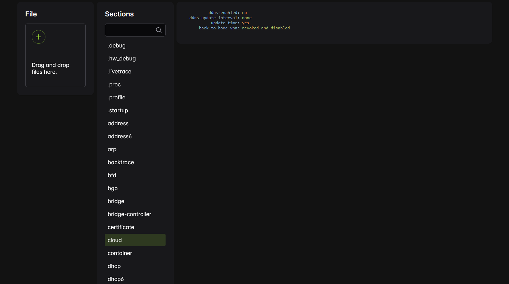

# Mikrotik RIF Viewer

This tool allows you to view the complete contents of `supout.rif` files with basic (and somewhat random) syntax highlighting.
It basically serves the same purpose as the viewer provided by Mikrotik themselves, except that it doesn't hide anything, looks better and doesn't require sending the files to any backend (all processing is done locally in the browser).

## Usage

1. [Open the tool](https://mikrotik-rif-viewer-derenderkeks-87883f8fa0a3e6e6625c350569ddd8.gitlab.io)
2. Drag and drop the `supout.rif` file into the upload box (or click the upload button and select it)
3. Click the section of interest
4. ???
5. Profit!
